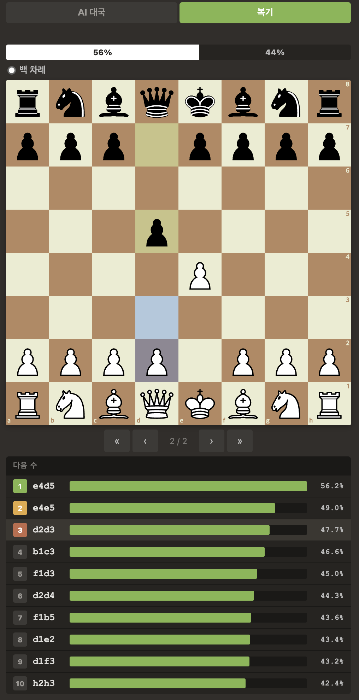

# Chess AI Web

Google DeepMind의 [Searchless Chess](https://github.com/google-deepmind/searchless_chess) 모델을 활용한 체스 웹 애플리케이션입니다. 트리 탐색 없이 신경망만으로 수를 평가합니다.



## Features

- **AI 대국** — 9M 파라미터 Transformer 모델과 대국
- **복기 모드** — 자유롭게 양쪽 수를 두며 분석
- **실시간 분석** — 각 수의 승률을 확률 바로 시각화
- **형세 평가** — 백/흑 승률 바 표시
- **잡힌 기물** — 양측 잡힌 기물과 점수 차이 표시
- **모바일 지원** — 터치 입력 및 반응형 레이아웃

## Prerequisites

- Python 3.10+
- JAX (GPU 권장, CPU도 가능)

## Setup

### 1. 의존성 설치

```bash
pip install -r searchless_chess/requirements.txt
pip install fastapi uvicorn
```

### 2. 체크포인트 다운로드

9M 모델 체크포인트가 필요합니다:

```bash
cd checkpoints
wget https://storage.googleapis.com/searchless_chess/checkpoints/9M.zip
unzip 9M.zip && rm 9M.zip
```

### 3. 실행

```bash
python server.py
```

http://localhost:8888 에서 접속할 수 있습니다.

## Project Structure

```
chess-web/
├── server.py                 # FastAPI 서버 (모델 로딩 + API)
├── checkpoints/              # 모델 체크포인트
│   └── 9M/
├── static/
│   ├── index.html
│   ├── app.js                # 체스 UI (Canvas 기반)
│   ├── style.css
│   ├── pieces/               # SVG 기물 이미지
│   └── boards/
└── searchless_chess/         # DeepMind searchless_chess 라이브러리
    └── src/
```

## API

| Endpoint | Method | Description |
|---|---|---|
| `/api/analyse` | POST | FEN을 받아 각 합법수의 승률 반환 |
| `/api/move` | POST | FEN을 받아 AI의 최선수 반환 |

## How It Works

Searchless Chess는 기존 체스 엔진(Stockfish 등)과 달리 MCTS나 알파-베타 같은 트리 탐색을 사용하지 않습니다. 대신 Transformer가 FEN 포지션을 입력받아 각 합법수의 action-value를 직접 예측합니다.

- **모델**: 9M 파라미터 Transformer (8 layers, 8 heads, 256 embedding dim)
- **학습 데이터**: Stockfish 16 평가값으로 레이블링된 1,000만 포지션
- **출력**: 각 수에 대한 승률 분포 (128 buckets)

## Credits

- [Searchless Chess](https://github.com/google-deepmind/searchless_chess) — Google DeepMind (Apache 2.0)
- Chess piece SVGs — [lichess](https://lichess.org)

## License

This project wraps DeepMind's Searchless Chess, which is licensed under Apache 2.0.
